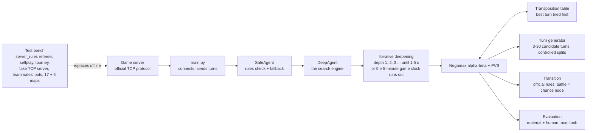

# Vampires vs Werewolves – Individual report (Dana)

15 November 2026 · Dana · branch `Dana`

## Summary

My bot is an iterative-deepening alpha-beta search (`deep_agent.py`) behind a legality gate (`safe_agent.py`), tested against an exact port of the server rules. It searches 6–9 plies deep in 1.5 s and beats three of the four teammates' bots; Mohamed's bot beats it.

- **Phase 1 (October):** a depth-2 expectiminimax bot plus the testing infrastructure: rules port, local game simulator, fake TCP server, test suite.
- **Phase 2 (9–11 November):** after the professor's advice ("go deep with alpha-beta"), a new search engine, then about ten fixes found by playing and tracing games.
- **Reliability:** no illegal move, crash or time-out in any of the 100+ games against teammates; slowest decision 1.59 s (limit 2 s).

## 1. Starting point: depth-2 expectiminimax

My first bot searched one turn for each player (depth 2), with chance nodes for random battles (expectiminimax, chapter 2 of the course). In a first head-to-head against Othmane's alpha-beta bot it won 9, drew 2 and lost 3 of 14 games, while using only 0.02–0.79 s of its 2 s per move.

| Component | File | Role |
| --- | --- | --- |
| Search | `search_agent.py` | Depth-2 expectiminimax |
| Battle model | `battle_model.py` | Official win probability P and expected survivors |
| Turn generator | `move_generator.py` | Up to 100 legal joint turns, best first |
| Evaluation | `evaluation.py` | Material + race for the humans |
| Rules port | `server_rules.py` | Exact copy of the official server's rules, used as referee |
| Safety gate | `safe_agent.py` | Every turn checked against the rules; fallback moves if anything fails |
| Test bench | `selfplay.py`, `fake_server.py`, `maps.py`, `test_*.py` | Local games, a fake TCP server, 17 test maps, unit tests |

The test bench turned out to be the most reusable part: every later result in this report was measured with it.

## 2. Redesign: deep alpha-beta search

The professor's advice (November meeting) set the direction: depth 4 is not enough and makes bots oscillate, random battles only as a last resort, splitting groups is good, maps up to 50×50. I rebuilt the search to use the whole time budget; mid-game it now reaches depth 6–9 at 20–35 thousand positions per second.



- **Alpha-beta, iterative deepening, transposition table** (course, chapter 2): deeper search in the same time; the best turn of the previous depth is tried first, which makes pruning effective.
- **Narrow, goal-directed turn generator** (my design): per group, a few moves toward a target (humans it can convert, a weaker enemy group, a friend to merge with, a safe cell) instead of all legal moves. Branching drops from hundreds to 3–30, which is what makes depth possible.
- **Random battles as chance nodes** (course: expectiminimax): two outcomes, weighted by the official probability. Whether a gamble is worth it is decided by the evaluation (see Key formulas below), not by a fixed rule.
- **Time safety:** clock checked every 32 positions, 1.5 s budget, budget reduced if the server's 5-minute game limit would run out.

### Where each part lives

| Component | Algorithm | File → function |
| --- | --- | --- |
| Entry point | Connects to the server, resets the engine at each new game | `main.py` → `run_game_loop` |
| Safety gate | Checks every turn against the official rules; falls back to the generator, then to any legal move | `safe_agent.py` → `SafeAgent.compute_moves`, `any_legal_turn` |
| State | Immutable tuple: our groups, their groups, humans, ply | `deep_agent.py` → `state_from_game` |
| Time control | 1.5 s per move, lowered if the 5-minute game clock would run out | `DeepAgent._budget` |
| Iterative deepening | Depth 1, 2, 3 … until the budget is used | `Searcher.search` |
| Alpha-beta (negamax) + PVS + transposition table | Prunes turns that cannot change the choice; null-window re-search after the first turn | `Searcher.negamax` |
| Chance nodes | Random battle = weighted average of win and loss, with Star1 pruning | `Searcher.turn_value` |
| Turn generator | Goal-directed options per group, combined best-first, Rule 5 checked | `gen_turns` |
| Transition | Official rules; one child per battle outcome | `apply_turn`, `win_probability` |
| Evaluation | Material + human race + kill threats, squashed by tanh | `evaluate`, `terminal_value` |
| Parameters | All tunable numbers in one place | `Params` |

### Key formulas

**Battle probability** (official rule, `win_probability`): a attackers against d defenders win with probability

```math
P(a,d)=\begin{cases}1 & a \ge d \text{ (humans) or } a \ge 1.5\,d \text{ (monsters)}\\[2pt] \dfrac{a}{2d} & a < d\\[6pt] \dfrac{a}{d}-\dfrac{1}{2} & d \le a < 1.5\,d \text{ (monsters)}\end{cases}
```

In the search tree a random battle has two children holding the rounded expected survivors: P × (a + h) after beating h humans, P × a after beating monsters, (1 − P) × d for the defenders after a loss. Its value is the expectation (expectiminimax):

```math
V = P\,V_{\text{win}} + (1-P)\,V_{\text{lose}}
```

**Evaluation** (`evaluate`), from the side to move, with m and t our and their creatures and H the humans left:

```math
v=\tanh\!\left(\frac{(m-t)+0.8\,R+K}{0.25\,(m+t)+0.5\,H}\right)\pm 0.1
```

The ±0.1 is the confidence bonus: +0.1 when the side to move is our bot, −0.1 otherwise. A finished game scores ±1.2, just above any unfinished position. Example: a 50/50 battle for the whole game is worth 0.5 × 1.2 + 0.5 × (−1.2) = 0, less than the +0.1 of playing on, so the bot refuses it unless its position is already worth less than 0.

**Human race** R: each human group goes to the side whose nearest group able to convert it (≥ h creatures) arrives first; ties go to the side to move. Each group's targets are sorted by distance d, and the k-th one (k = 0, 1, 2 …) is worth

```math
h \cdot \gamma^{\,d-1} \cdot q^{\,k}, \qquad \gamma = 0.9,\ q = 0.6
```

The growth pass then queues human groups that nobody can convert yet behind a group's current targets, using its size after those conversions. Example: 12 vampires with 4 humans 2 cells away and 15 humans 7 cells away (enemy group of 12 far away) score 0.18 without the growth pass and 0.41 with it, because the 15 become reachable after the 4.

**Kill threats** K: + 0.8 × e for an enemy group of e creatures we can wipe out next move (≥ 1.5×, adjacent), 0.15 × e × γ^(d−2) when further away; − 0.6 × c for one of our groups of c creatures that an enemy group can wipe out within 2 cells, − 0.15 × c × γ^(d−3) further away.

## 3. Iterations: problems found in games and how they were fixed

Every fix below started from a game the bot lost or nearly lost, which I replayed and traced move by move. The biggest gains came from fixing the evaluation's sense of risk (rows 2 and 5) and its planning on large maps (rows 6, 8, 9).

| # | What went wrong (seen in a game) | Fix | Measured effect |
| --- | --- | --- | --- |
| 1 | On `thetrap`, stepped next to the enemy and turned a forced win into a 50/50 battle | Candidate steps ranked by exposure: safe cells first | Forced win found |
| 2 | At 19 vs 19, attacked in a 50/50 battle for the whole game: the search scored it 0, the same as playing on | +0.1 "confidence" bonus for our side in unfinished positions, so a coin flip loses to playing on unless we are behind | No more even gambles; the professor's "last resort" rule now follows from expected value |
| 3 | Our 64 creatures wiped out by an enemy 4 that attacked at 3 % | The search now expects every possible enemy attack, however unlikely | Big groups stop parking next to tiny enemies |
| 4 | A 1.50 s search took 1.69 s in total | Python's garbage collector (0.19 s pause) switched off | Slowest move 1.50 s |
| 5 | Threw a winning game (76 vs 65) on a 21 % attack: a finished game was worth twice a big lead | Win score 2.0 → 1.2; the tanh scale sharpens as humans run out | Score vs my old bot about 59 % → 66 % (44 games) |
| 6 | On 50×50 maps, merged into one slow blob and was out-collected | Queue discount: a group's 2nd, 3rd … target counts less; up to 6 groups | Large maps vs old bot: 37.5 % → 67.5 % (20 games) |
| 7 | Forfeited a game it was winning 309 vs 228 by moving 260 creatures (the protocol allows 255) | Moves capped at 255, with a test | No forfeit since |
| 8 | Neighbouring groups tried to merge into each other: 626 of 640 candidate turns broke Rule 5, the search starved and once sent an empty turn | The smaller group joins the bigger one; the generator always returns a legal turn | 271 → 7,537 positions searched in that position; large maps vs Othmane: lost both on `big50_30` → 79 % |
| 9 | Groups ignored human groups bigger than themselves, even when growing first would make them reachable | Growth pass: count humans a group can take after converting its current targets | Large maps vs Othmane: 79.2 % → 87.5 % (12 games) |

## 4. Results against the teammates' bots

My bot beats Harsha's, Othmane's and Ronita's bots, and loses to Mohamed's. Each teammate's bot ran unmodified at its own time budget; every map was played once from each side (8 standard maps + 4 large ones, 40×40 to 50×50), refereed by the rules port.

**Overall score of my bot** (wins + half the draws, over all games): Harsha 81 %, Othmane 71 %, Ronita 65 %, Mohamed 38 %.

| Opponent | Wins / draws / losses | Standard maps | Large maps |
| --- | --- | --- | --- |
| Harsha (parallel MCTS) | 18 / 3 / 3 | 78 % | 88 % |
| Othmane (alpha-beta)\* | 18 / 4 / 6 | 59 % | 88 % |
| Ronita (MCTS) | 14 / 3 / 7 | 47 % | 100 % |
| Mohamed (MCTS) | 9 / 0 / 15 | 44 % | 25 % |

\* Tested with 6 large maps instead of 4, hence 28 games.

The pattern: strong on large maps, about even on standard ones. All 15 losses to Mohamed's bot were on material at the 200-ply limit, 7 of them by 6 creatures or fewer; 6 of my 9 wins against it were total wipe-outs.

**How these numbers were measured**, so anyone can reproduce them with `tourney.py` and `tcp_match.py`:

- **Versions:** my bot at commit `283c029` (`Dana` branch); opponents at Harsha `88600de`, Ronita `c9f42ee`, Mohamed `aafd28c`, Othmane `475549f` (Apex V3.1), each unmodified at its own time budget (1.4–1.65 s).
- **Referee:** `server_rules.py`, the port of the official server's rules; 200 plies maximum; an illegal or empty turn loses the game.
- **Fairness:** every map played twice with sides swapped, so first-move advantages cancel out; fixed random seeds, so every game can be replayed.
- **Uncertainty:** one standard error is about ±10 points for 24 games, so differences under about 15 points between two opponents are not meaningful.

Othmane's report gives a different result for our pair (his bot 6–4 against mine over 10 games). The bot versions and the test protocol differ, so the team's final ranking should come from one shared round-robin run under the protocol above.

## 5. What did not work

Four ideas were tested and not adopted; each is still in the code as an option, switched off.

| Idea | Result | Why |
| --- | --- | --- |
| Exposure penalty (push split groups to merge), all game | 18 % vs Mohamed (2 wins in 11, stopped) vs 44 % without | Too timid: merged into one group early and left humans uncollected |
| Same penalty, only after the humans are gone | 37.5 % vs 44 % (16 games each) | Merging only brings the final battle back to about 50/50 (our 113 + 9 vs their 122: they still attacked at 58 % and won) |
| More groups (6 instead of 4) on its own | 55.3 % vs 55.9 % vs my old bot | No effect until the evaluation valued parallel collection (row 6 above) |
| Principal variation search | 4 % fewer positions at depth 5 | Correct (same values) but a small gain; kept on |

One method lesson: my first experiments ran while I was still editing the code, so a single run mixed two versions. Every result in this report comes from a frozen copy of the code.

## 6. Testing and tools

All 13 test files pass on the pushed version (`Dana` branch, commit `283c029`). The tools below are reusable by the whole team.

| Tool | What it checks or does |
| --- | --- |
| `test_deep_agent.py` | 4,029 generated turns from 442 real positions: all legal under the official rules, and the simulated result identical to the server's. Also: an answer within budget on every map, the 255-creature limit, and the crowded position that once produced an empty turn |
| `test_end_to_end.py` | Real games over TCP against the fake server; slowest answer 1.50 s |
| `tourney.py` | Head-to-head matches, both sides of every map, fixed random seeds, two games in parallel |
| `rival_bots.py` | Loads a teammate's bot unmodified, with its own game engine |
| `tcp_match.py` | Plays against any external program over TCP (used for Harsha's bot, which starts its own processes) |
| Maps | 17 test maps from `maps.py` + 6 generated large maps, 25×40 to 50×50 |

## 7. Limitations and next steps

The main remaining weakness is the race for humans on standard-size maps: Mohamed's bot comes out of it slightly ahead, and with equal material the ending is close to a coin flip.

- **Evaluation estimates each human group separately.** Mohamed's bot simulates the race in sequence (captures in order, groups growing, contested houses), and collects faster on medium maps (94 vs 75 creatures at ply 21 on `s14x20`). A sequential race simulation is the most promising next step, at a cost in search depth.
- **Not enough splitting on medium maps:** 2 groups where Mohamed's bot uses 5–6.
- **Python speed:** 20–35 thousand positions per second; on 50×50 maps depth drops to 4–6, so long-range planning relies on the evaluation.
- **Uncertainty:** 24 games per opponent gives about ±10 points; small symmetric maps are often decided by who moves first plus one random battle.
- **Test maps:** the large maps are my imitation of the professor's generator; the real tournament maps may differ.
