# The Splitter: how a Vampires vs Werewolves AI evolved

*The complete lifecycle of our model, from the first prototype to the final tournament
configuration: the strategies we tried, the ideas we fused from other bots, every major
experiment and what it taught us.*

This document is the narrative companion to the technical chapters in
[strategy/](strategy/README.md). Every number below comes from those chapters and the stored
arena results (`arena/results/`). The figures are standalone SVG files in [figures/](figures/),
ready to be copied into a report.

---

## At a glance

| | |
|---|---|
| **The game** | Two species on a grid race to convert human houses and destroy each other; 2 s per move, any illegal move loses |
| **Our idea** | *Smart splitting*: send detachments of exactly the right size to several houses at once, while the main body stays safe |
| **The engine** | A plan generator (about 15 joint plans per turn) + Monte Carlo Tree Search over those plans + a race-projection evaluation, in plain Python |
| **Lifecycle** | 5 hand-built versions (v1–v5), then 6 improvement campaigns (v6–v10), 18 October – 1 November 2026 |
| **Ideas tested** | About 55 after v5, each measured; **6** reached the final model, 49 are in the do-not-retry register |
| **Final flagship** | **Splitter-R3**: our planner fused with RaceMCTS's dice-driven rollouts, plus good-odds first strikes and a "desperate opponent" model |
| **Final backup** | **Splitter-Classic**: the campaign-2 flagship (v7), the runner-up and a genuinely different player |
| **Evidence** | Flagship beats backup by **+8.0 ± 2.1 points** over four map families never used for tuning; beat every earlier generation on a final ladder; **0 illegal moves** in thousands of games |

### The lifecycle in one picture

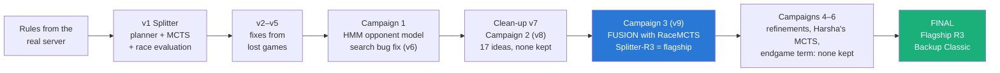

| Version / campaign | Date | What happened | Outcome |
|---|---|---|---|
| v1 | Oct 18–19 | Planner + MCTS + race evaluation | 81% vs the team's bots (84 games) |
| v2–v5 | Oct 18–19 | Fixes from lost games: merge-aware race, pincers, 30% strike rule, protected plans, contest-aware race | 79.1% over 448 games against a stronger panel |
| v6 (campaign 1) | Oct 20 | HMM opponent modelling; a search bug found and fixed | Bug fix **+2.2 points**; HMM not adopted |
| v7 | Oct 20 | Clean-up of every rejected experiment | Flagship unchanged |
| v8 (campaign 2) | Oct 21 | 17 ideas: search, caching, path planning, swarm, evaluation fitting | Nothing beat the flagship |
| **v9 (campaign 3)** | **Oct 23–25** | **Fusion with RaceMCTS + tactical fixes** | **Splitter-R3: +8.0 ± 3.9, new flagship** |
| v10 (campaign 4) | Oct 25 | Tempo fix, safer race plans, improving the backup | Nothing adopted; anytime watchdog kept |
| v10 (campaign 5) | Oct 31 | More thinking time, Harsha's MCTS reviewed, ladder of all generations | Nothing adopted; flagship confirmed strongest |
| v10 (campaign 6) | Nov 1 | Endgame "hunted group" term (final iteration) | Nothing adopted; final models fixed |

---

## Part I · First steps: building the Splitter (v1–v5)

### 1. The problem

Vampires vs Werewolves is a two-player, turn-based game on an n × m grid. Each species starts as
one group; human houses are scattered over the board. On its turn a player moves any number of
groups one cell in any of 8 directions, and a group may split.

- **Converting humans** needs at least as many creatures as humans in the house; they join us.
- **Killing an enemy group for sure** needs 1.5× its size; every other fight is a random battle.
- The bigger species wins when one disappears or the ply/time limit is reached.
- **2 seconds per move**, and an illegal or empty move counts as cheating and ends the game.

The brief asked for an AI that "takes into account the opponent's moves", and forbade AI, tree
or graph libraries: everything is plain Python standard library.

### 2. Ground truth: the rules as the real server applies them

We did not trust the PDF alone. We played **scripted probe games** against the official server
and **disassembled its rules code** (`VVSW.Model.dll`). Three findings shaped everything after:

| Finding | Why it mattered |
|---|---|
| **A much smaller attacker can still win.** When the defender is ≥ 1.5× bigger, the PDF says the attackers die; the server runs a random battle with P = E1/(2·E2). Verified live: 6 attackers beat 10 defenders in 1 game out of 8 | The starter kit (and later several teammates' bots) got this wrong. Our threat model counts these attacks |
| **Arrivals on one cell are summed before the battle.** Two groups of 3 entering a house of 5 together convert it for sure | Made the **pincer** plan possible |
| **Exact battle odds and survivor rules** (`GetProba`, `PerformRandomBattle`), the cheating checks (`CheckMoves`), counts stored as bytes (255 wraps around) | Our simulator `splitter/rules.py` is an exact copy, and every move we send passes the server's own checks |

### 3. The idea: smart splitting

Most bots, including the starter kit and Othmane's Apex, keep **one big group** (a
"deathball") and walk it from house to house: safe, but one house at a time. The Splitter grows
faster:

- it sends **detachments of exactly h creatures** to houses of h humans. Each converts for sure and comes back with 2h;
- the **main body keeps the rest** and stays big enough to be safe.

Two dangers, two answers:

| Danger | Answer |
|---|---|
| Small groups get picked off | Every detachment passes a **safety check**: no enemy can catch it on the way or right after it converts; the main body must stay bigger than nearby enemies |
| Splitting explodes the number of possible moves | We do not search raw moves. Each turn a **planner proposes ~15 joint plans** (macro-actions), and MCTS searches over those |

### 4. The engine

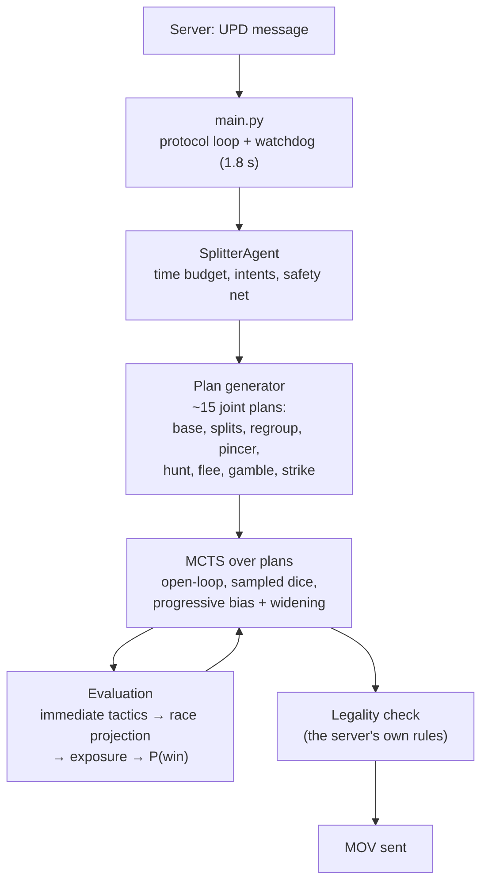

- **Plan generator** ([chapter 03](strategy/03_plan_generator.md)): ranked goals per group (house, kill, flee, merge, gamble), one safe step per order, then plan families. The core family is `splitN`: detachments to several houses at once. "Protected" plans (flee, regroup, hunt, pincer) are never truncated away.
- **Evaluation** ([chapter 04](strategy/04_evaluation.md)): every group is a "runner" in a projected race for the houses, merge-aware and contest-aware. Exposure subtracts what the enemy can take next turn, and a sigmoid that sharpens as the game ends turns the margin into P(win).
- **Search** ([chapter 05](strategy/05_search_mcts.md)): MCTS handles the dice naturally, is anytime, and spends its time on promising lines. The opponent is modelled as an equally clever splitter that strikes first whenever adjacent at ≥ 30% odds.
- **Safety net** ([chapter 06](strategy/06_agent_and_safety.md)): every answer is validated against the server's cheating rules, with fallbacks down to an emergency one-step move. A watchdog answers at 1.8 s, whatever happens.

### 5. Learning from lost games: v1 to v5

Every early improvement came from **reading a game the bot lost**:

| Version | Change | The lost game behind it | Effect |
|---|---|---|---|
| v1 | Baseline: planner + MCTS + race evaluation | — | 81% (84 games), 100% on village maps |
| v2 | **Merge-aware race**, **commitment**, **pincer** | prize map: our 19 creatures split 12 + 7 while Apex took the 18-house and hunted us | Prize map won vs Apex as both species; 82.7% |
| v3 | **The opponent may strike at P ≥ 0.3**; evaluation **sharpens late** | testmap: our 16 stepped next to RaceMCTS's 14, which struck first at 44% and won | — |
| v4 | **Protected plans**; **flee into open space** | village map: with 6 groups the only flee plan was truncated and a group was eaten | Apex 73% → 92% |
| v5 | **Contest-aware race**, reserve radius 6, planner caches (×4 speed) | close-start map: splitting 8 into 3 + 5 next to the enemy fed it every house | RaceMCTS 48% → 72%; **79.1%** on 448 games |

### 6. Does splitting actually pay?

We tested the hypothesis instead of assuming it: the same bot with splitting switched off.

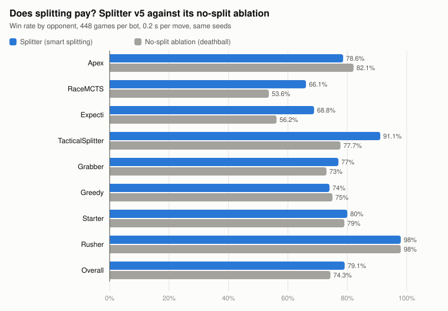

*Figure 1. Splitter v5 against its no-split ablation, 448 games each, same seeds.*

| Map family | Splitter | No-split |
|---|---|---|
| Many small villages | **91–94%** | 69–78% |
| Open symmetric maps | **75–97%** | 70–81% |
| Prize / testmap / close start | 63% / 75% / 59% | **88% / 86% / 69%** |

- **Confirmed overall** (79.1% vs 74.3%, and twice the material margin: +20 vs +9 creatures), strongly on maps with many small houses.
- **The deathball wins where concentration is needed**: one huge house, or an enemy close at the start.
- Rules that tried to detect those cases (`split_enemy_dist`, `prize_lock`, a map-aware deathball) were all *worse* than letting the search decide.

And at tournament speed the effect grows:

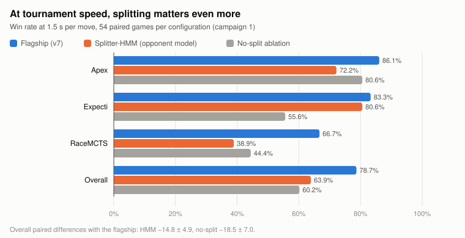

*Figure 2. At 1.5 s per move the no-split bot loses 18.5 points (5 at 0.2 s). The opponent-model
variant of Part II loses 14.8.*

---

## Part II · Trying to read the opponent (campaign 1, v6–v7)

### 7. Opponent modelling with Hidden Markov Models

Opponents differ a lot, measured from our game logs:

| Opponent | Splits | Attacks at < 50% odds | Moves toward us |
|---|---|---|---|
| Apex | 0% | 0% (only sure kills) | 38% |
| RaceMCTS | 11% | 15% | 50% |
| Greedy / Starter | 0% | 40–57% | ~90% |
| TacticalSplitter | 4% | 88% | 29% |

So we built, from scratch (no AI libraries), a full opponent-modelling stack
([chapter 11](strategy/11_opponent_modeling.md)):

1. **Move reconstruction**: the server never reports the opponent's move. We rebuild it from two boards, agreeing with the true moves on **≥ 99.6%** of turns.
2. **A style HMM** (modes EXPAND, HUNT, GAMBLE, DEFEND, SPLITFARM) trained with our own Baum-Welch. Held-out log-likelihood improved from −1.67 to −0.94 per turn.
3. **A goal recognizer** (Bayesian inverse planning) and a **policy HMM** that picks which expert policy the opponent follows:

| Bot | Policy HMM next-cell accuracy | Best single predictor | Uniform guess |
|---|---|---|---|
| Apex | **43%** | 33% | 14% |
| Expecti | **53%** | 43% | 12% |
| Greedy / Starter | **92% / 97%** | 90% / 96% | 12% |
| TacticalSplitter | **35%** | 26% | 15% |

**Accurate predictions, but no use of them won games:**

| Use of the predictions | Effect |
|---|---|
| Steering the search toward likely replies | RaceMCTS **−9** (under-explores dangerous replies) |
| Pre-emptive plans (deny, ambush, shield, tempo) | **−3.9** |
| Risk model + adaptive settings ("Splitter-HMM") | +7 to +10 on the tuning set, **−11.9 ± 4.1 at 1.5 s** |

Our search already assumed a strong, splitting, striking opponent. Against strong bots that is
the right model, and narrowing it to "likely" replies under-explored the dangerous ones.

### 8. The side discovery that paid: a search bug

While integrating the model, the agent's error log revealed that the open-loop MCTS sometimes
expanded a plan that had become illegal in the sampled future (a group had died in a random
battle earlier in the iteration). The whole search for that turn was lost. **This happened on
4.1% of v5's turns.** One legality check at expansion gave **+2.2 points**, a 61.6% head-to-head
win rate against v5, and RaceMCTS 66% → 73%. It was the largest single gain since v5.

### 9. Campaign 1: learning to distrust our own numbers

Campaign 1 screened 14 candidates, then validated the best ([chapter 12](strategy/12_experiments.md)):

| Candidate | Tuning set | Unseen opponents and maps | Decision |
|---|---|---|---|
| Open-loop expansion fix | — | **+2.2** (504 paired games), clear mechanism | **Adopted** |
| Opponent model without steering | +7.4, +10.4 | ≈ +0.6 ± 1.1; pre-registered test **−3.4 ± 2.5** | Runner-up, later retired |
| Endgame kiting + rollout depth 0 | **+11.3** (best) | −0.6 ± 2.0 | Rejected |

**The lesson that shaped the rest of the project:** the best of 14 noisy results always looks
impressive. From here on, every candidate had to survive data it was not selected on. This
became our method:

| Principle | How |
|---|---|
| Separate tuning and validation data | Tuning maps and opponents vs hold-out maps, then a **new map family for every validation**, used once |
| Paired comparisons | Every candidate plays exactly the same games (map, side, seed) as the reference |
| Tournament speed | Final verdicts at 1.5 s per move (the HMM was neutral at 0.2 s, −14.8 at 1.5 s) |
| Pre-registration | Decision rules written **before** the games |
| Never fit the teammates' bots | Randomized `Styled:<n>` opponents that play like no teammate |

---

## Part III · Exploring widely (campaign 2, v8)

### 10. Seventeen ideas, none kept

Campaign 2 implemented the whole future-ideas list ([chapter 14](strategy/14_campaign2.md)):
tree reuse between turns, sequential halving, risk-aware choice, transposition caches, safe
space-time corridors, house tours, interception, exact detachment selection, pincer kills,
retaliation-aware safety, group caps, endgame moves, the game clock as a resource, and fitting
the evaluation on game outcomes.

- **On the screen,** all were within ±1 standard error of the flagship, except planner rollouts (−5.9: too slow).
- **On unseen data,** every screen winner changed sign: interception +2.6 → −3.5, group cap +2.6 → −2.8, exact detachments +2.2 → −1.7.

**The most interesting failure: a better evaluation that did not play better.** Fitting the
evaluation's constants on game outcomes cut the hold-out log-loss by 9% and fixed a measured
calibration error:

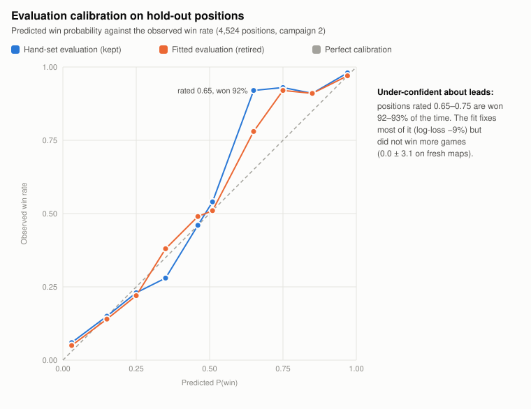

*Figure 3. The hand-set evaluation is under-confident about leads. The fitted one is better
calibrated but scored exactly **0.0 ± 3.1** against the hand-set one on fresh maps. Better
forecasts are not better decisions.*

Two more findings from this campaign:
- **Thinking time matters a lot:** with half its 1.5 s budget, the flagship lost **25.0 ± 10.9 points**.
- **Testing got 2–3× cheaper:** "informative slots" (only games where configurations can disagree), early stopping of clearly worse candidates, and resumable runs. Adjudicating games early was rejected: late gambles flip 2–7% of "decided" games.

---

## Part IV · Fusion: merging the flagship with RaceMCTS (campaign 3, v9)

### 11. What we took, and what we refused

Ronita's RaceMCTS had one clear strength: **long, dice-driven rollouts** that play fights out.
It also had weaknesses we did not want: a simulator built on the starter kit's wrong battle rule,
no split safety and no exposure model. The fusion took only the strength
([chapter 16](strategy/16_splitter_r.md)):

| Component | Origin | What it does | Kept? |
|---|---|---|---|
| Race rollouts (`rollout_policy="race"`) | RaceMCTS | Its stochastic goal policy, re-implemented on **our exact rules** | ✅ |
| First strikes in rollouts (45%) | RaceMCTS | Both sides strike first in rollouts from 45% odds | ✅ |
| Deep rollouts **in contact only** (6 plies) | Fusion design | 6 plies when enemies are within 3 cells, 2 elsewhere | ✅ |
| Leaf mixing (0.5) | Fusion design | Half the value before the rollout, half after | ✅ |
| Race root plans | RaceMCTS | Its plan families added at the root | ✅ |
| Anti-bait kill check | Code review | Discount a kill that walks into a counter-attack | ✅ |
| Trusted plans, transposition cache, tree reuse ("speed half") | Code review | Faster search | ❌ +2–4% iterations only |
| Aggressive opponent replies (`opp_race`) | Code review | RaceMCTS-style replies in our tree | ❌ −2.5 ± 7.6 |

**Why "in contact only".** A gate test of uniform rollout depth showed that depth cuts both
ways: depth 8 everywhere gained +25 against Expecti but lost −20.8 against Apex. Deep rollouts
help where tactics decide, which is in contact.

### 12. How the fused model wins, and how it lost

**Validation** (hold-out maps + the teammates' live bots, 1.5 s): Splitter-R **+6.2 ± 4.6**.
The mechanism was visible in the results:

| | Wins | Draws | Losses |
|---|---|---|---|
| Classic flagship | 60 | **27** | 43 |
| **Splitter-R** | **79** | 5 | 46 |

**It turns draws into wins**: the race rollouts make it play for the win where the classic
flagship settled for a standstill. Its biggest gain (+35) came against a gambling style that no
teammate plays. The gain did not come from fitting the teammates.

**But it lost by being wiped out.** Reading its lost games showed two causes:

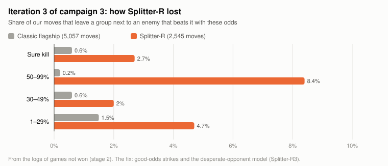

*Figure 4. Splitter-R left a group within a 50–99% strike on 8.4% of its moves (the classic
flagship 0.2%).*

1. **First-strike exposure.** The fused aggression left groups where the enemy strikes first at good odds.
2. **The desperate opponent, a blind spot of both models.** Example: Splitter-R leads 40 to 26, no humans left, and steps next to an enemy 17 it would kill for sure next turn. The 17 strikes first at **21%**, wins, and wipes us out. For a losing opponent, any chance beats a sure loss, and a smart bot (Dana's Expecti) takes it.

Two targeted fixes followed:
- **Good-odds first strikes** (`strike_p=0.6`): offer a strike plan when we beat an adjacent group with ≥ 60% but not for sure, even when not behind. 13 against 10 wins 80% of the time; waiting lets the enemy strike us at 38%. Screen **+5.0 ± 6.9**.
- **The desperate-opponent model** (`desperate_p=0.1`): when the opponent is losing, it is modelled as willing to strike from 10% odds, in the tree, the planner, the evaluation and the rollouts. Screen **+7.5 ± 7.7**.

### 13. The pre-registered final

Fresh maps never used before, the live teammate bots and six never-used styles, 1.5 s, 144
games per model. The rule, written in advance: adopt only if above 2 standard errors.

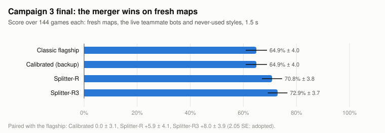

*Figure 5. Splitter-R3 = Splitter-R + good-odds strikes + the desperate-opponent model.*

| Paired Δ vs the classic flagship, by opponent | Splitter-R | **Splitter-R3** |
|---|---|---|
| Apex-live | +3.1 | +3.1 |
| RaceMCTS-live | −15.6 | −12.5 |
| **Expecti-live** (the low-odds striker) | 0.0 | **+18.8** |
| Gambling deathball style | +15.6 | +15.6 |
| Cautious, never-gambling styles | +6.2 / +28.1 / −3.1 | +12.5 / **+34.4** / −3.1 |
| **Overall** | +5.9 ± 4.1 | **+8.0 ± 3.9 (2.05 SE)** |

- **The fix worked where it was aimed:** against Expecti, R3 gained +18.8 where R gained nothing. Strikes under 30% that destroyed half our army while ahead: classic 2, **R3 0**.
- **Real conditions** (real protocol, 2 s limit, the live bots including the new Apex V3): **9 wins, 1 draw, 2 losses, 0 timeouts, 0 illegal moves**.
- **Decision:** Splitter-R3 became the flagship. The classic flagship became the backup, chosen for diversity: it loses differently (more draws, far fewer wipeouts).

---

## Part V · Refinement and its limits (campaigns 4–6)

### 14. Campaign 4: fixes that were right, but invisible in games

([chapter 17](strategy/17_campaign4.md)) A tempo fix (`keep_away`: don't step into a desperate
opponent's reach when far ahead) solved its target puzzles 5/5 (was 0/5). Safer race root plans
removed the exposure of Figure 4. Both won their screens by **+13.3** and **+12.5**, and gave
**+1.4 ± 4.3** together on new maps: not adopted. The situations they fix are rare, and the
flagship mostly wins them anyway.

Kept: an **anytime watchdog answer**. If a search is late, the client sends the search's best
plan so far instead of a naive step.

Also confirmed: **moving second is structural.** In a mirror match the first player scores 75%
against 44%, because the symmetric maps favour the first mover. Not a weakness of our bots.

### 15. Campaign 5: Harsha's MCTS, more thinking time, and the ladder

([chapter 18](strategy/18_campaign5.md)) **Harsha's new bot** is RaceMCTS-style plans plus *root
parallelism* (an independent tree on every core but one).

| Part | Harsha | Our flagship |
|---|---|---|
| Rules model | Starter kit (wrong 1.5× defender rule) | Exact copy of the server |
| Plans | RaceMCTS families | Our planner **plus** the same race families |
| Rollouts | 8 plies everywhere, no first strikes | Race rollouts with first strikes, deep only in contact |
| Selection | Plain UCT, c = 0.9 | UCT c = 0.6 + planner priors + widening |
| Cores | All but one | One (a project rule) |

| Measurement | Result |
|---|---|
| Flagship vs Harsha, one core (arena) | **71.4%** (backup 53.6%) |
| Flagship vs Harsha's real client with 3 processes | **4 – 4** |
| Flagship vs Apex V3.1 | **80.4%** (backup 67.9%) |

Harsha's strength is its cores, not its design. Its two settings that could have complemented
ours, and "optimization 1" (more thinking time), were screened:

| Variant | Δ vs flagship | Kept? |
|---|---|---|
| 1.7 s per move instead of 1.5 s | −7.5 ± 5.7 | no |
| 8-ply contact rollouts (Harsha) | −11.7 ± 6.5 | no |
| Exploration c = 0.9 (Harsha) | −17.8 ± 7.5 | no |

**The "strongest version" ladder:** every generation played the same 160 games on maps nothing
had been selected on.

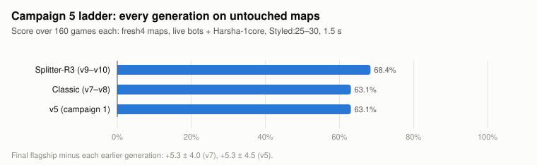

*Figure 6. The final flagship beat both earlier generations (+5.3 each).*

**The non-MCTS bots** (Apex V3.1's alpha-beta, Dana's expectiminimax, the rule-based bots) were
reviewed for ideas: transit pruning, chance nodes, pooled kill threats, an endgame solver. A
loss-log measurement ranked them. Pooled-attack kills caused only **0.4%** of our group losses.
Replays of Harsha's wins showed a far more frequent pattern: **split groups hunted down once no
humans are left** (25 of the flagship's 83 lost groups on the ladder).

### 16. Campaign 6, the final iteration: the endgame "hunted group" term

([chapter 19](strategy/19_campaign6.md)) On a king-move board, one bigger pursuer always corners
a single group, so once no humans are left, a group that a bigger enemy can kill for sure is
already lost. Our 6-ply rollouts cannot see that far. We added an evaluation term that counts
such a group as lost. It checked out mechanically: the thetrap position went from "stay split"
to "merge", and it was inert when off (300/300 identical decisions).

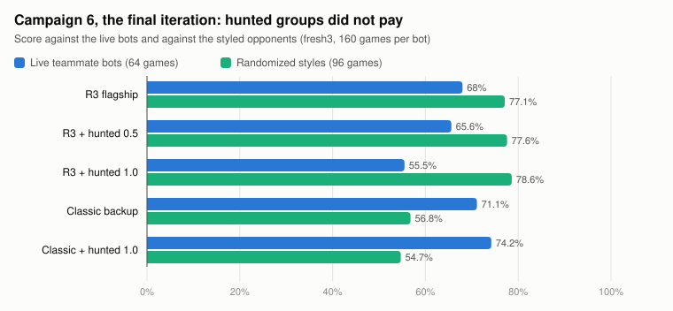

*Figure 7. On the still-unused `fresh3` maps the term cut the targeted losses (9 → 5) but cost
12.5 points against the live bots at full weight. Not adopted.*

---

## Part VI · The final model

### 17. Configuration

| Model | Role | Configuration | Tournament command |
|---|---|---|---|
| **Splitter-R3** | Flagship | `rollout_policy="race", rollout_strike=0.45, rollout_depth_contact=6, leaf_mix=0.5, race_root=True, bait_check=True, strike_p=0.6, desperate_p=0.1` | `python main.py <ip> <port>` |
| **Splitter-Classic** | Backup (runner-up) | All defaults (= the frozen v7) | `SPLITTER_MODEL=backup python main.py <ip> <port>` |

Both make the same decisions as their validated frozen versions on **300 of 300** test
positions, and 48 automated tests pass.

### 18. The evidence that it is the strongest version

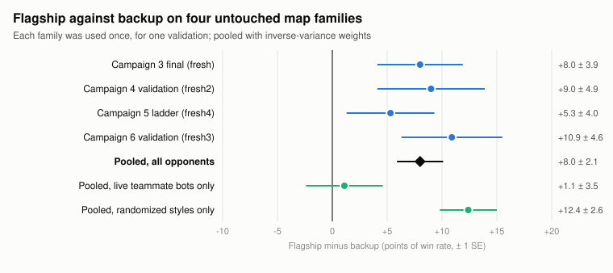

*Figure 8. Each map family was used for exactly one validation. Pooled: **+8.0 ± 2.1** (3.8 SE).*

- **Against every earlier generation** on the final ladder: +5.3 vs v7, +5.3 vs v5.
- **Where the edge comes from:** against the randomized styles +12.4 ± 2.6; against the live teammate bots the two models are level (+1.1 ± 3.5). The backup is a real alternative, not a weaker copy.
- **Robustness:** 0 illegal moves and 0 crashes in every campaign. The only timeouts were caused by the machine (an overnight sleep, a Windows Update), never by the bot. On the real server: slowest move 1.48 s, won 18–14 against Apex.

### 19. The fusion map: where each part of the final model came from

| Part of the final flagship | Origin | Campaign |
|---|---|---|
| Smart splitting, exact-size detachments, safety check | Our own design | v1 |
| Merge- and contest-aware race evaluation, pincers, protected plans | Our lost games | v2–v5 |
| 30% first-strike threat model | A loss to RaceMCTS | v3 |
| Open-loop expansion check | Bug found while building the HMM | v6 |
| Race rollouts, first strikes in rollouts, race root plans | **RaceMCTS (Ronita)** | v9 |
| Deep rollouts in contact only, leaf mixing | Fusion design (merger study) | v9 |
| Anti-bait check, good-odds strike plans | Code review | v9 |
| Desperate-opponent model | Losses to **Expecti (Dana)** | v9 |
| Anytime watchdog answer | Code review | v10 |

| Idea from other bots | Result |
|---|---|
| Deathball (Apex, starter) | Beaten by splitting (Figure 1); kept as a style we test against |
| Opponent prediction (our HMMs) | Accurate, no gain; retired |
| Harsha's root parallelism | Excluded (one-core rule); its 8-ply rollouts and c = 0.9 lost |
| Apex's endgame search (cheap form) | The hunted-group term: lost against the live bots |
| Dana's pooled kills | Measured at 0.4% of losses; not built |

---

## Part VII · What we learned

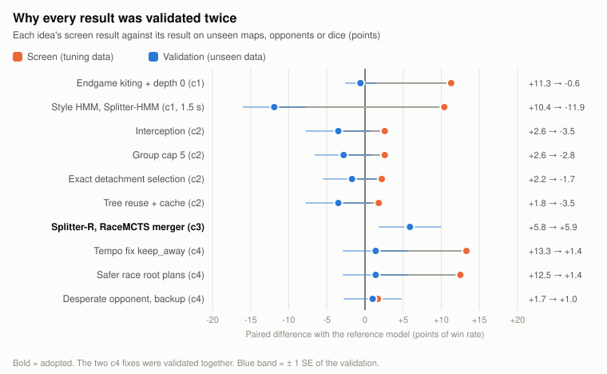

*Figure 9. Almost every idea that won its screen shrank or reversed on unseen data. The one that
held (bold) had a mechanism found in lost games.*

1. **Screening winners are mostly noise.** With n candidates, the best shows +1.5 to +2 SE by chance. Every screen winner except one changed sign or vanished on unseen data.
2. **Validate at tournament speed.** The style HMM was neutral at 0.2 s and clearly harmful at 1.5 s.
3. **Better prediction ≠ better play.** The HMMs predicted well and the fitted evaluation forecast better; neither won games.
4. **The design sits at a robust local optimum.** About 55 measured variations found few real gains: the search bug fix and the RaceMCTS fusion with its tactical fixes.
5. **The gains came from new mechanisms found in lost games,** not from parameters: deep contact rollouts turned draws into wins, and the desperate-opponent model came from reading how we were wiped out.
6. **A fix that is right on its puzzles can be invisible in games.** Its gain depends on how often the situation decides a game.
7. **A stronger opponent's settings are not its strength.** Harsha's bot is level with ours because of its cores, not its rollout depth or exploration constant.
8. **A frequent loss pattern is not yet a gain.** An evaluation term changes every search that reaches the situation, for both sides, so its side effects reach far beyond the positions it was written for.

### The full register, in numbers

**Rejected** (entries in the do-not-retry register; some entries bundle several variants):

| Area | Rejected entries |
|---|---|
| Opponent modelling and prediction | 6 |
| Planner, path planning, swarm orchestration | 18 |
| Search and decision making | 15 |
| Evaluation | 3 |
| Time, clock and game-level ideas | 4 |
| Testing shortcuts | 3 |
| **Total** | **49** |

**Adopted after v5** (6): the open-loop expansion check (v6); the RaceMCTS fusion (race
rollouts with first strikes, deep only in contact, leaf mixing, race root plans) (v9); the
anti-bait check (v9); good-odds strike plans (v9); the desperate-opponent model (v9); the
anytime watchdog answer (v10).

Every rejected idea, with its numbers, likely reason and retry condition, is in
[15 · Failed strategies](strategy/15_failed_strategies.md).

---

## Appendix A · Version and campaign results in one table

| Step | Headline result | Data |
|---|---|---|
| v1 | 81% vs the team's bots | 84 games, 0.2 s |
| v5 | 79.1% ± 1.9 (no-split 74.3%) | 448 games, 0.2 s |
| v6 | +2.2 vs v5; 79.3% vs a 9-bot panel | 504 games, 0.2 s |
| v7 at 1.5 s | 78.7% ± 5.6 (HMM 63.9%, no-split 60.2%) | 54 paired games |
| Campaign 2 | No candidate above noise; calibrated evaluation +1.3 ± 6.1 at 1.5 s | Screen (136 paired games per candidate) + 3 validation stages |
| Campaign 3 final | R3 72.9% vs 64.9%: **+8.0 ± 3.9** | 576 games, fresh maps |
| Campaign 3 real conditions | 9 – 1 – 2, 0 timeouts | 12 games, real protocol |
| Campaign 4 validation | Flagship − backup +9.0 ± 4.9; candidates +1.4 / +1.0 | 576 games, fresh2 |
| Campaign 5 ladder | R3 68.4%, v7 63.1%, v5 63.1% | 480 games, fresh4 |
| Campaign 6 validation | R3 73.4%, Classic 62.5%; candidates −0.6 / −4.1 / 0.0 | 800 games, fresh3 |

## Appendix B · Glossary

| Term | Meaning |
|---|---|
| Paired difference (Δ) | Win-rate difference between two bots on exactly the same games (map, side, dice seed), in points; ± is one standard error |
| SE | Standard error. A difference below ~2 SE can be noise |
| Screen | A first, fast test on the tuning maps and opponents |
| Validation | A test on maps, opponents or dice not used to choose the candidate |
| Map family (`fresh`, `fresh2`, `fresh3`, `fresh4`) | A set of 8 new maps, each used for one validation only |
| `Styled:<n>` | Reproducible randomized opponent styles that play like no teammate |
| Live bots | The teammates' actual tournament entry points (Apex, RaceMCTS, Expecti, Harsha) |
| Real conditions | Games over the real protocol with the real time limits, through our tournament client |
| Pre-registration | Writing the decision rule before playing the games |

## Appendix C · Where to find more

| Topic | Chapter |
|---|---|
| Rules and server evidence | [02](strategy/02_game_rules_and_server.md), [SERVER_FINDINGS](SERVER_FINDINGS.md) |
| Planner, evaluation, search, safety | [03](strategy/03_plan_generator.md), [04](strategy/04_evaluation.md), [05](strategy/05_search_mcts.md), [06](strategy/06_agent_and_safety.md) |
| Testing methodology and tools | [07](strategy/07_testing_and_benchmarking.md) |
| All results and versions | [08](strategy/08_results_and_iterations.md) |
| Parameters | [10](strategy/10_parameters.md) |
| Campaigns 1–6 | [11](strategy/11_opponent_modeling.md), [12](strategy/12_experiments.md), [14](strategy/14_campaign2.md), [16](strategy/16_splitter_r.md), [17](strategy/17_campaign4.md), [18](strategy/18_campaign5.md), [19](strategy/19_campaign6.md) |
| Every failed idea | [15](strategy/15_failed_strategies.md) |

The figures were drawn from the numbers above as plain SVG (no plotting library). Each carries
its own title, description and per-mark tooltips, and can be inserted into a report directly.
